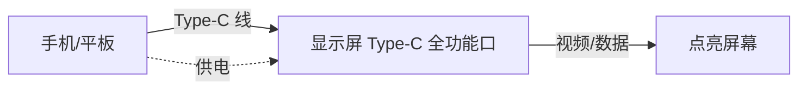
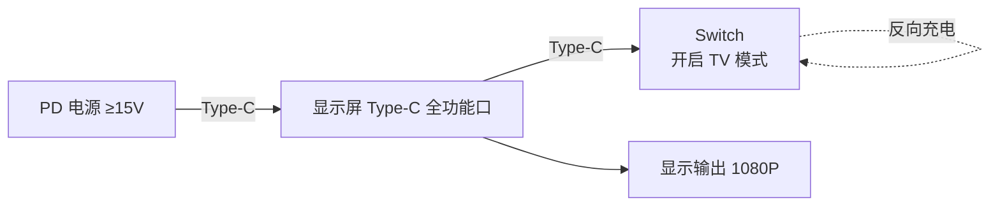
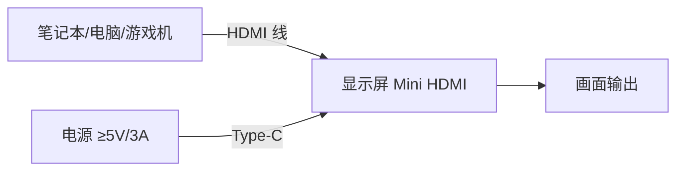
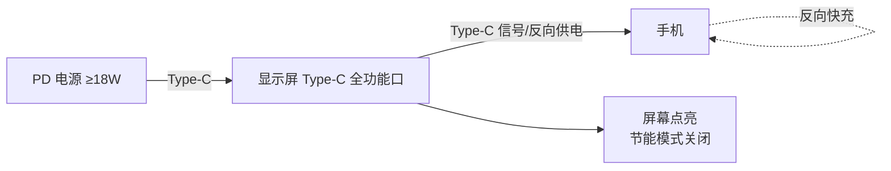
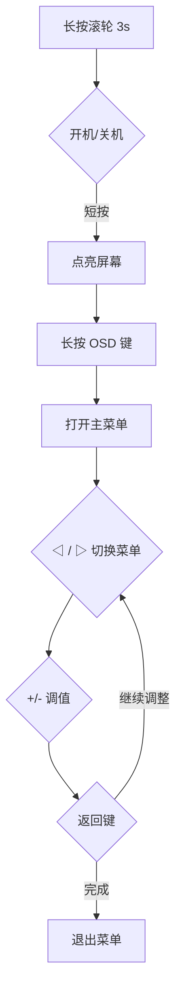
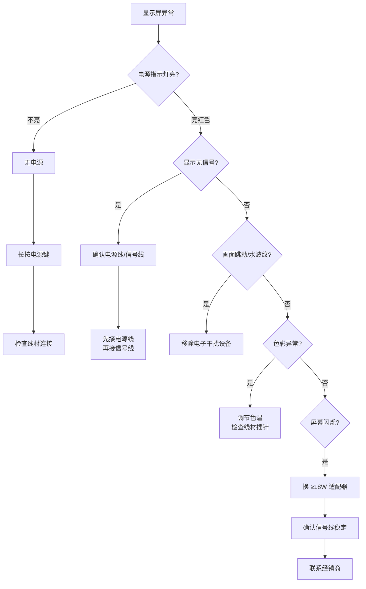

+++
title = "aigo 便携显示屏备忘"
date = "2026-10-19 10:00:00+08:00"
[taxonomies]
tags = ["备忘", "硬件", "便携屏"]
+++

aigo 国民好物 · 便携式显示屏 产品使用说明书 VER3.4 备忘。

## 接口

- **Type-C 全功能口**：支持 PD 电源供电（5V/9V/12V/15V/19V/20V 输入），支持 PD 投屏和数据投屏。
- **Type-C 信号接口/反向供电口**：Mini/标准 Type-C 端口。
- **Mini HDMI**：信号输入/反向供电口。
- **3.5mm 耳机孔**：外接 3.5mm 耳机输入。

## 按键（滚轮 + OSD）

- **滚轮**：调亮度/音量；长按滚轮开机/关机。
- **OSD 菜单**（机身后方按键排）
  - `-/+(◁/▷)`：切换/调节数值
  - `OSD`：打开主菜单
  - `返回`：退出菜单
  - `电源/返回`：返回上一级
- 操作：长按 OSD 打开主菜单 → `◁/▷` 切换菜单 → `+/-` 调值 → 返回键退出。

## 连接方式

### 1. Type-C 连接

- **手机/平板**：Type-C 线一端连手机，另一端连显示屏 Type-C 全功能口。注意插头方向，插反插不进去。
- **Switch**：用标配 Type-C 线连接 Switch 的 Type-C 口与显示屏 Type-C 口，支持 HD 投屏。

  - **外接 15V PD 电源时**：外部电源同时给显示屏和 Switch 供电，Switch 机身电池进入充电状态，显示输出 **1080P**。
  - 需打开 Switch TV 模式。

### 2. HDMI 连接

- 用 HD 线一端连显示屏 Mini HDMI 口，另一端连视频输出设备（笔记本/电脑/游戏机等）。
- 顺序：**先接供电，再接 HD 线**，供电电源不小于 **5V/3A**。

### 3. 外接供电接线

- 给显示屏 Type-C 全功能口接 PD 电源，另一根 Type-C 线从显示屏 Type-C 信号口接手机/Switch。
- **无外接电源时**：手机电池给显示屏供电，进入节能模式，亮度自动降到 30%，可手动调整。
- **有外接电源时**：显示屏可反向给手机充电，建议使用 ≥18W 充电器/充电宝，更高功率可快充。

## 常见问题及处理

| 序号 | 故障现象 | 可能原因 | 解决方法 |
| --- | --- | --- | --- |
| 1 | 显示屏不亮，电源指示灯不亮 | 无电源 | 长按电源按钮；检查设备是否开机；检查线材是否正确连接 |
| 2 | 显示屏不亮，电源指示灯显示红色 | 无信号，进入睡眠模式 | 确认电源线、开机状态、信号线、信号源输出 |
| 3 | 显示无信号 | 无信号 | 确认电源线和信号线；重新插拔线材（**先接电源线，再接信号线**） |
| 4 | 屏幕图像跳动或出现水波纹 | 电子干扰 | 确认电源线和信号线连接；移除周边电子干扰设备 |
| 5 | 色彩显示不好 | 色温/线材插针弯曲 | 调节色温；确保线材没有插针弯曲 |
| 6 | 屏幕闪烁 | 供电不足；信号不稳定 | 优先使用 ≥18W 适配器；确认信号线连接稳定；未解决联系经销商 |

## OSD 菜单操作流程

滚轮：长按 3s 开关机；短按唤醒屏幕。长按 OSD 进入菜单，`◁/▷` 切换菜单项，`+/-` 调值，返回键退出。

## 故障排查决策树

## 小贴士

- PD 电源协议为 **15V** 时才能同时给 Switch 和显示屏供电并充 Switch。
- Type-C 口插拔方向要注意，插反插不进去，不要硬插。
- 接 HDMI 时切记**先供电再接信号线**，否则信号传输可能异常。
- 节能模式下亮度自动限制到 30%，想要更亮必须外接电源。