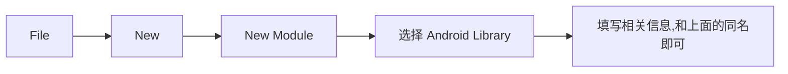
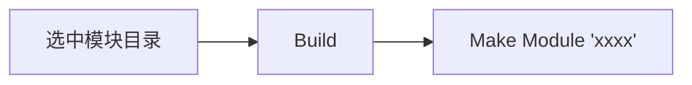
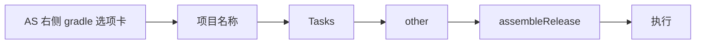

+++
title = "安卓打包aar"
date = "2026-10-21 08:00:00+08:00"
[taxonomies]
tags = ["安卓", "android", "aar"]
+++

## 新建项目

## 新建模块

## 编写相关逻辑

略

## 打包 aar

打包产物在 `build/outputs/aar` 下 `*-debug.aar`, 根据文件名可知是 <kbd>debug</kbd> 版本的
如果需要 <kbd>release</kbd> 版本的, 按照如下步骤

打包产物在 `build/outputs/aar` 下 `*-release.aar`
